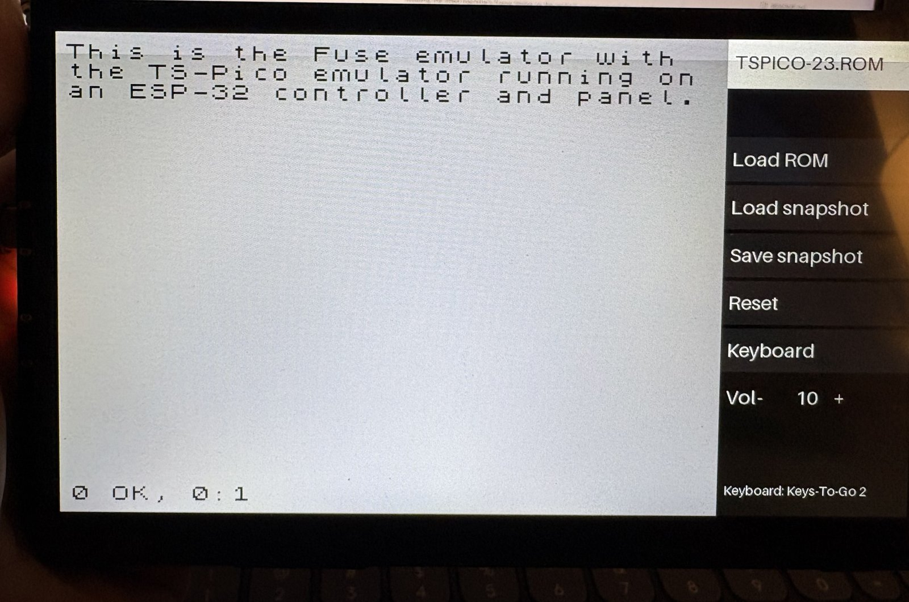

# esp32-2068

A standalone Timex/Sinclair 2068 with a TS-Pico, running on an Elecrow CrowPanel Advanced 7" ESP32-P4.



The emulator runs on one P4 core; the real TS-Pico MicroPython firmware runs on the other. See [PLAN.md](PLAN.md) for the architecture and phases.

## Layout

| Path | Contents |
|---|---|
| `boards/` | `CROWPANEL_P4_7`, the MicroPython board this is built as (a 4 MB app partition) |
| `usermods/` | The MicroPython modules that join the layers: `ts2068` (the machine on the panel, plus `emu.py`, `osd.py`, `btkbd.py`, `kbdmap.py`, `main.py`), `p4bridge`, and `hosted` (the C6's Bluetooth controller). `usermods/micropython.cmake` is the build's entry point |
| `platform/` | P4 display, audio, touch, on-screen keyboard, menu area (`platform.cmake`) |
| `machine/` | TS2068 machine, SCLD, paging and sound, lifted from Fuse (`machine.cmake`) |
| `z80/` | Fuse's Z80 core (`z80.cmake`); `z80_jls/` is the one not chosen |
| `tspico/` | `p4bridge` queues, and the Python that runs the firmware on the P4 |
| `tools/` | `p4/`: install, card setup, sessions, the release downloads (`make_release.py`); `host/`: comparisons against Fuse |
| `firmware/` | Submodule: tspico-firmware-build (pinned) |
| `third_party/` | Read-only reference submodules; see [PROVENANCE.md](third_party/PROVENANCE.md) |
| `docs/` | [DECISIONS.md](docs/DECISIONS.md), [NOTES.md](docs/NOTES.md) |
| `test/` | Trace fixtures, Z80 suites, BASIC test programs |

## Installing without building

Each [release](https://github.com/timex-sinclair-projects/ts2068-p4/releases) has two downloads:

- **`ts2068-p4-VERSION.zip`** holds `ts2068-p4-VERSION.bin`, the board's whole 16 MB flash: MicroPython with the emulator, the TS-Pico firmware, and the menu.
- **`ts2068-p4-sd-VERSION.zip`** is the microSD card: the ROMs (the TS2068's own, and the TS-Pico's, which it starts with), and the TS-Pico's card files.

You need [esptool](https://docs.espressif.com/projects/esptool/) (`pip install esptool`). Plug the panel's **UART** USB-C port into the computer; it shows up as a CH340 serial port (`/dev/cu.wchusbserial*` on a Mac, `/dev/ttyUSB*` on Linux, `COM*` on Windows).

1. Optional, but the only way back to Elecrow's demo: save what's on the board now.
   ```bash
   esptool --chip esp32p4 --port PORT read-flash 0 0x1000000 crowpanel-factory.bin
   ```
2. Write the image. This replaces everything on the flash.
   ```bash
   esptool --chip esp32p4 --port PORT write-flash 0x0 ts2068-p4-VERSION.bin
   ```
3. Unzip the card zip onto a FAT32 microSD card, put it in the panel, and reset it. The TS2068 starts with the TS-Pico ROM.

To pick another ROM, use **Load ROM** in the menu; ROM files go in `/TS2068/ROMS` on the card.

Writing the whole image also clears a paired Bluetooth keyboard: pair it again from the menu.

## Getting the source

```bash
git clone --recurse-submodules https://github.com/timex-sinclair-projects/ts2068-p4.git
```

## Running it

Build MicroPython with our board and modules, flash it, then put our files on the board's flash and the ROMs on its microSD card (docs/NOTES.md has the details):

```bash
cd ~/esp/micropython/ports/esp32
make BOARD_DIR=<repo>/boards/CROWPANEL_P4_7 USER_C_MODULES=<repo>/usermods/micropython.cmake
esptool --chip esp32p4 write-flash 0x10000 build-CROWPANEL_P4_7/micropython.bin
cd <repo>
python3 tools/p4/install.py
python3 tools/p4/sd_roms.py
```

At power-on `main.py` starts the TS2068 from the card's `/TS2068` folder, with the TS-Pico firmware plugged in when the ROM is the 32K TS-Pico one, and puts the menu in the side panel above the on-screen keyboard (or in the whole side panel while a Bluetooth keyboard is connected). To boot to the REPL instead, create `/p4/noboot` on the flash.

It needs MicroPython v1.29.0 and ESP-IDF v5.5.2 (docs/DECISIONS.md D3).

The release downloads are made from a build with `uv run --with littlefs-python --with esptool tools/p4/make_release.py`, into `dist/`.

**A Bluetooth keyboard:** tap **Keyboard → Pair a keyboard** in the menu with the keyboard in pairing mode. It's remembered, and reconnects at power-on when a key is pressed. The keys type what they say; Ctrl or Alt is SYMBOL SHIFT, Esc is BREAK, Tab is extended mode. BLE keyboards only: the C6 has no Bluetooth Classic. Pairing has no passkey for now (docs/DECISIONS.md D8).

## License

GPL-2.0-or-later (`LICENSE`), since Fuse's Z80 core was chosen (docs/DECISIONS.md D5). Lifted code keeps its own header and attribution (`third_party/PROVENANCE.md`):

- `machine/`, `z80/`: from Fuse and fuse-tspico, GPL-2.0-or-later.
- `z80_jls/`: ESPectrum's Z80_JLS, **GPL-3.0**. Nothing links it by default; a build made with it (`TS2068_CORE=jls`) is GPL-3.0 as a whole.
- The TS-Pico firmware (`firmware`, a submodule) and MicroPython: MIT.
- `platform/p4_osd_font.h`: Aileron Regular, CC0 1.0.
